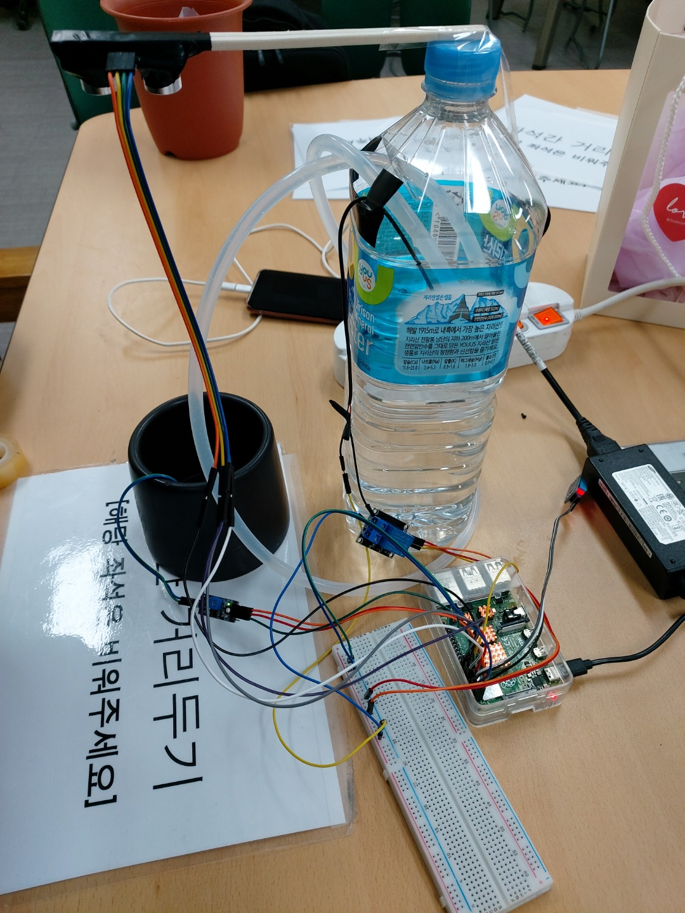
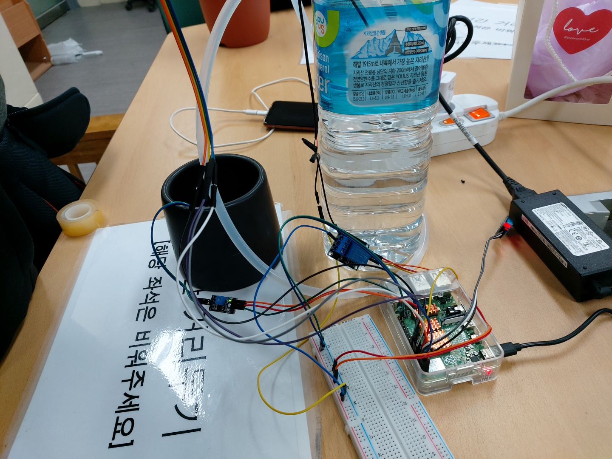
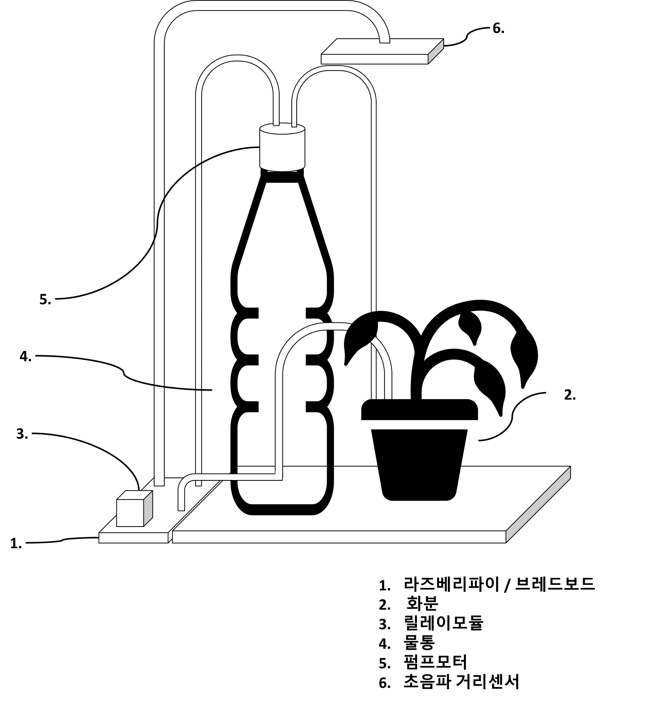
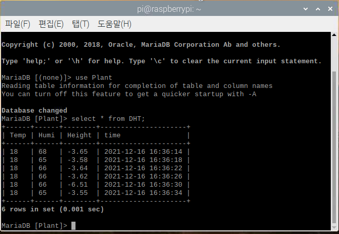
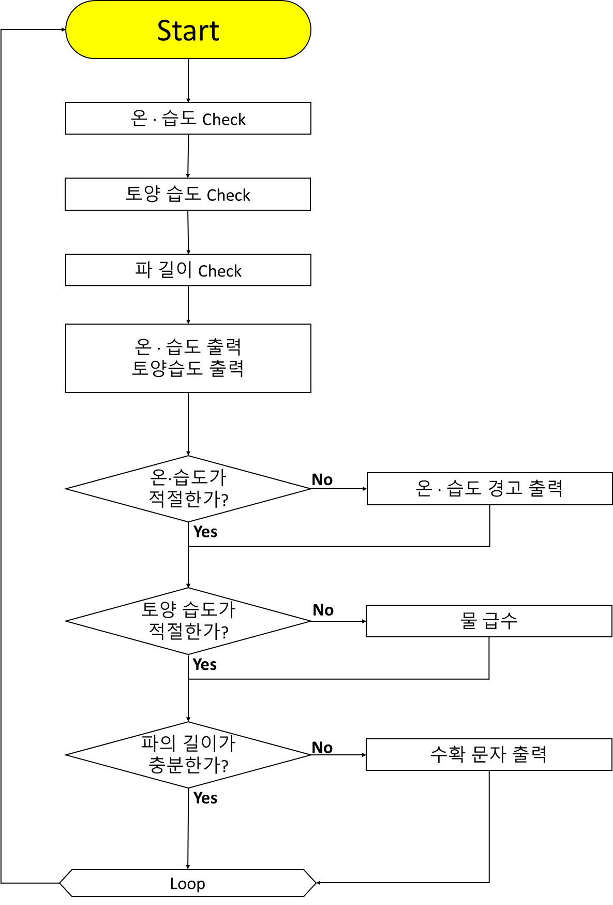
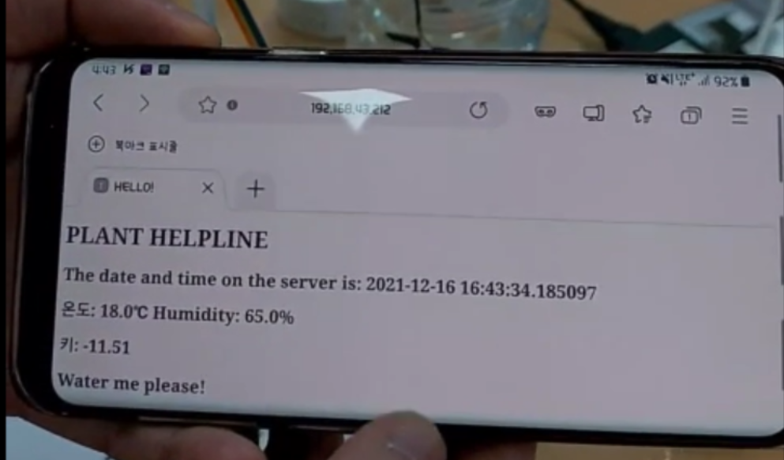
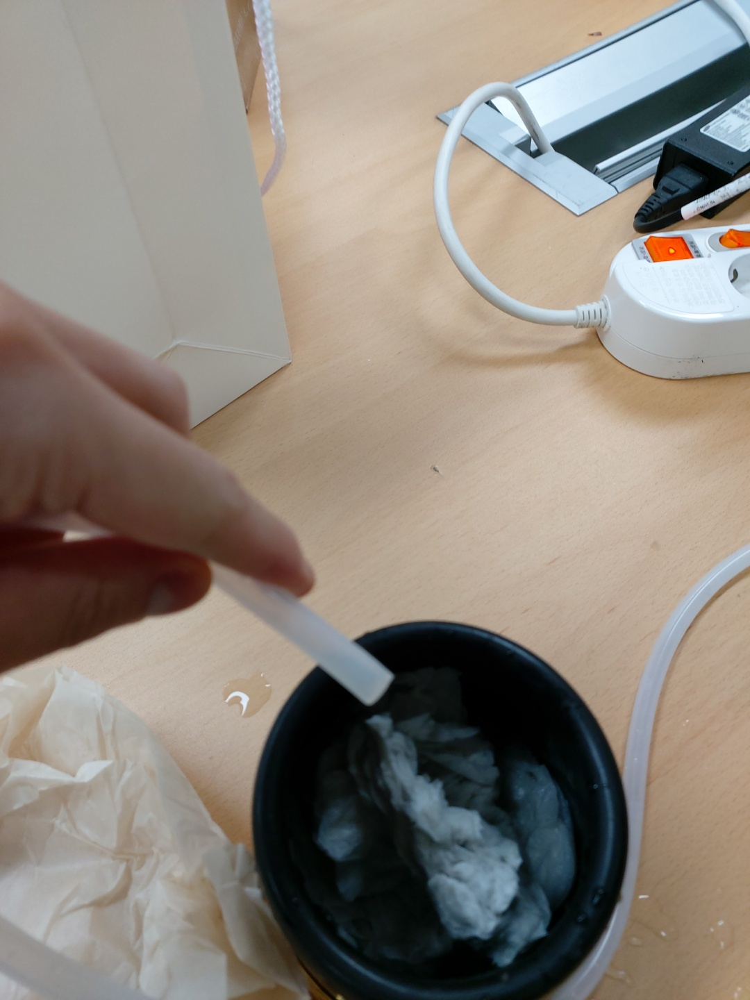
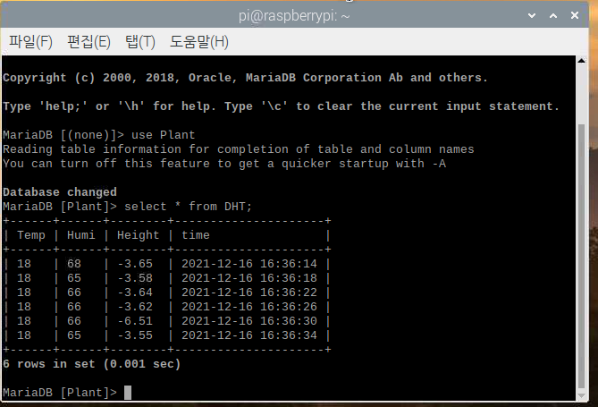
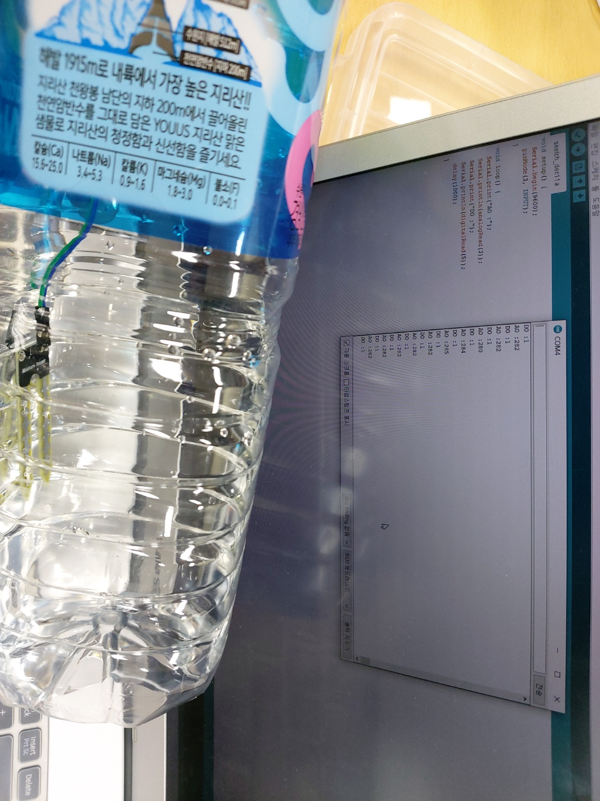
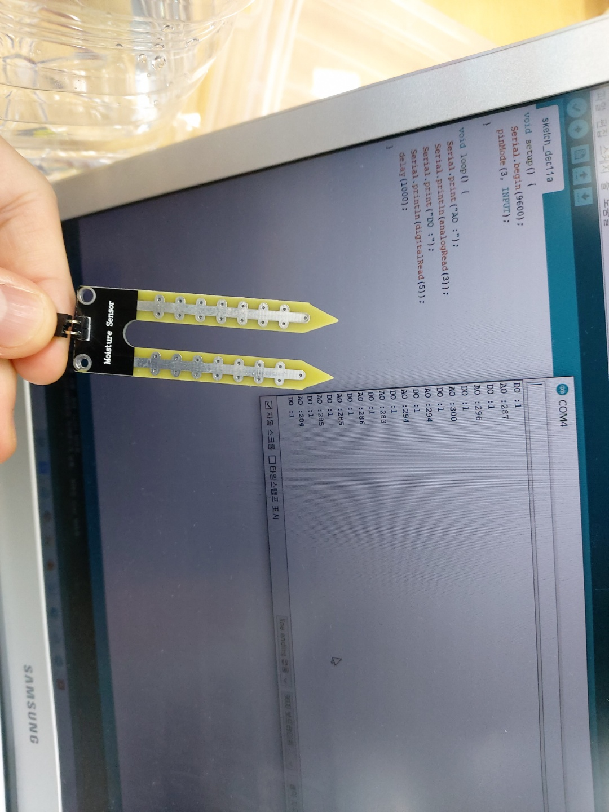

# ICT-Convergence-Engineering_HomeGardeningProject
> **2021학년도 2학기 ICT융합공학 (캡스톤디자인) 수업 프로젝트**
> **라즈베리 파이(Raspberry Pi) 기반 IoT 스마트 홈 가드닝 & 모니터링 시스템**

---

## 1. 프로젝트 개요 (Overview)

<p align="center">
  
  
</p>

- **과제명**: 스마트 대파 화분 프로젝트
- **과제 유형**: 시제품 제작 및 IoT 소프트웨어/하드웨어 시스템 통합
- **개발 기간**: 2021년 2학기 (2021.09 ~ 2021.12)
- **개발 배경**:
  - 기상 이변 및 태풍으로 인한 대파 가격 폭등(“파테크” 열풍)에서 착안.
  - 대파는 타 작물 대비 생육 난이도가 낮아 실내 재배에 적합하다는 점에 주목.
  - 바쁜 1인 가구 및 직장인도 손쉽게 집에서 유기농 대파를 재배·수확할 수 있도록 라즈베리 파이 기반의 자동 환경 측정, 자동 급수, 스마트폰 수확 알림 시스템을 구현.

---

## 2. 팀 구성 및 역할 분배 (Team Roles & Responsibilities)

본 프로젝트는 3인 팀으로 진행

### 이병한
- 팀장 / 개발자
  - 프로젝트 총괄 및 전체 시스템 아키텍처 설계
  - 프로젝트 일정 조율
  - 결과보고서 및 발표 자료 최종 총괄
  - 하드웨어 회로 설계 및 센서 인터페이스 구축
  - 급수 제어 로직 구현
  - 데이터베이스 설계 및 환경 구축 (`MySQL`)

### 강○○○
- 개발자
  - 자료조사
  - 하드웨어 회로 설계 및 센서 인터페이스 구축
  - Flask 기반 통합 웹 서버 개발
  - 데이터베이스 설계 및 환경 구축 (`MySQL`)
  - IFTTT 스마트폰 수확 알림 연동
  - 웹 대시보드 데이터 연동 지원 및 DB 텍스트 파일 내보내기 구현
### 손○○
- 개발자
  - 자료조사
  - 하드웨어 회로 설계 및 센서 인터페이스 구축
  - 토양 수분 센서의 상온/수중 입출력 값(ADC/Digital) 비교 분석 및 오류 진단
  - 데이터베이스 설계 및 환경 구축 (`MySQL`)

---

## 3. 시스템 설계 및 구조도 (System Design)

### 3.1. 기초 구상도 (Concept Design)
라즈베리 파이를 중앙 제어 허브로 두고, 상단에는 초음파 센서와 온습도 센서, 화분 내부에는 토양 수분 센서와 급수 호스를 설치

<p align="center">
  
</p>

### 3.2. 회로도 (Circuit Diagram)
라즈베리 파이 GPIO와 센서/액추에이터 간의 결선도

<p align="center">
  
</p>

- **DHT11 온습도 센서**: GPIO 4 (DATA), VCC(3.3V), GND
- **초음파 센서 (HC-SR04)**: GPIO 18 (Trig), GPIO 24 (Echo), VCC(5V), GND
- **토양 수분 센서**: GPIO 17 (Digital In) / GPIO 11, VCC, GND
- **릴레이 모듈**: GPIO 22 (Control), VCC, GND $\rightarrow$ DC 워터 펌프 모터 구동

### 3.3. 소프트웨어 동작 순서도 (Flowchart)
전체 시스템의 주기적 센서 측정, DB 저장, 웹 제어 및 IFTTT 알림 흐름

<p align="center">
  
</p>

---

## 4. 디렉터리 및 소스코드 구성 (File Structure)

```text
├── ICT융합공학 팀프로젝트.pptx     # 발표 자료 (슬라이드 21장)
├── 팀프로젝트 수행결과보고서.hwp    # 최종 수행결과보고서
├── README.md                         # 본 프로젝트 문서
├── images/                           # 문서 및 이미지 에셋 - 구상도, 회로도, 시제품, 대시보드 캡처
└── src/                              # 분리된 파이썬 소스코드
    ├── water.py                      # 워터 펌프 및 토양 수분 기본 제어 모듈
    ├── auto_water.py                 # 백그라운드 자동 급수 상시 실행 스크립트
    ├── distance.py                   # HC-SR04 초음파 거리 측정 모듈
    ├── height_check.py               # 대파 생육 추적 및 IFTTT 수확 알림 데몬
    ├── db_logger.py                  # 센서 데이터를 MySQL에 주기적으로 로깅
    ├── web_plants.py                 # Flask 기반 모니터링 & 원격 제어 웹 서버
    └── templates/
        └── main.html                 # 웹 대시보드 HTML 템플릿
```

### 소스코드 상세 설명

1. **`src/water.py` (급수 제어)**
   - GPIO 22번 릴레이를 제어하여 워터 펌프를 1초간 가동(`pump_on`).
   - 급수 시 `last_watered.txt`에 일시를 기록하고, `get_last_watered()`로 조회.
   - `auto_water()`: 토양 수분 센서 상태를 주기적으로 읽어 건조할 경우 펌프 자동 동작.
2. **`src/distance.py` (거리 측정)**
   - HC-SR04 센서의 Trig 신호 발신 및 Echo 반사 수신 시간차를 측정하여 물체와의 거리(cm) 계산:  
     $$\text{distance} = \frac{\Delta t \times 34300}{2}$$
3. **`src/height_check.py` (생육 높이 추적 & 알림)**
   - 화분 상단 기준 높이(21cm)에서 대파 끝까지의 거리를 빼서 실제 식물 높이를 계산:  
     $$\text{height} = 21 - d$$
   - 높이가 17cm를 초과하면 IFTTT Maker Webhook URL을 호출하여 사용자 스마트폰으로 즉시 수확 알림 발송.
4. **`src/db_logger.py` (DB 로깅)**
   - 3초 주기로 온·습도와 대파 길이를 측정하여 로컬 MySQL DB(`Plant.DHT`)에 INSERT.
5. **`src/web_plants.py` (웹 서버)**
   - Flask 기반 포트 80 웹 서버.
   - 대시보드에서 온·습도, 대파 길이, 현재 급수 상태를 실시간 확인.
   - 수동 급수(`/water`), 자동 급수 토글(`/auto/water/ON`, `/auto/water/OFF`), 최근 급수 일시 조회(`/last_watered`), DB 텍스트 내보내기(`/db`) 지원.

---

## 5. 실행 및 시연 결과 (Demonstration)

### 5.1. 웹 대시보드 & 원격 급수 동작
웹 브라우저를 통해 라즈베리 파이의 IP로 접속하여 현재 온·습도와 대파 길이를 실시간 확인하고 원격 급수를 실행

| 웹 대시보드 화면 | 급수 펌프 동작 모습 |
| :---: | :---: |
|  |  |

### 5.2. MySQL 데이터 적재
측정된 센서 데이터(온도, 습도, 식물 길이, 측정 시간)가 MySQL 테이블에 실시간으로 저장

<p align="center">
  
</p>

---

## 6. 트러블슈팅 (Troubleshooting)

<p align="center">
  
  &nbsp;&nbsp;&nbsp;&nbsp;
  
</p>

- **토양 수분 센서 신호 이상 현상**:
  - 테스트 과정에서 토양 수분 센서가 상온(공기 중)과 물속 모두에서 디지털 신호 `1`, 아날로그 신호 `282 ~ 285`로 거의 동일한 값을 출력하는 하드웨어적 이상 현상 발생
  - **원인 분석**: 센서 프로브 접점의 전도성 저하 또는 모듈 보드의 전위차 비교 회로 결함으로 분석
  - **대응 조치**: 추후 새로운 센서 구매를 통해 보강 예정

---

## 7. 향후 발전 방향 (Future Works)

1. **완전 제어형 스마트팜(Smart Farm) 확장**:
   - 현재 시스템은 온습도/광도를 단순 측정·모니터링하는 수준이나, 식물 생장용 LED(광도 제어), 온열 시트/쿨링 팬, 소형 가습기를 추가 연동하여 완전 제어형 폐쇄형 스마트팜으로 업그레이드 가능
2. **카메라 모듈 기반 생육 영상 타임랩스**:
   - 라즈베리 파이 카메라(Pi Camera)를 결합하여 대파가 자라나는 과정을 일자별 타임랩스로 기록하고 웹 대시보드에서 스트리밍 지원
